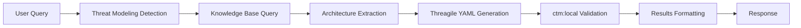

# Threat Modeling Integration Guide

## Overview

This guide explains how to integrate the automated Threagile threat modeling capabilities with your existing DeepResearch Open WebUI pipe.

## Prerequisites

1. **Open WebUI Knowledge Base**: Ensure you have architecture documentation loaded into an Open WebUI knowledge base
2. **ctm:local Docker Image**: Build or obtain the ctm:local Docker container for Threagile validation
3. **API Access**: Ensure your Open WebUI instance is accessible at the configured URL (default: <http://localhost:3003>)

## Integration Steps

### 1. Install Dependencies

Add the following dependencies to your environment:

```bash
pip install aiohttp pyyaml
```

### 2. Apply the Extension

Modify your existing `pipe` file to integrate threat modeling:

```python
# At the top of your pipe file, add the import
from threat_modeling_extension import extend_pipe_with_threat_modeling

# Apply the decorator to your existing Pipe class
@extend_pipe_with_threat_modeling
class Pipe:
    # Your existing Pipe implementation remains unchanged
    pass
```

### 3. Configure Valves

The extension adds new configuration options to your pipe's valves:

- `threat_modeling_enabled` (bool): Enable/disable threat modeling functionality
- `threat_modeling_iterations` (int): Maximum iterations for threat model generation (default: 3)
- `openwebui_base_url` (str): Base URL for Open WebUI API (default: <http://localhost:3003>)
- `knowledge_base_id` (str): Specific knowledge base ID to query (optional)
- `ctm_docker_image` (str): Docker image name for ctm:local validation (default: ctm:local)

### 4. Prepare Knowledge Base

Load your architecture documentation into Open WebUI:

1. Create a knowledge base in Open WebUI
2. Upload architecture documents, diagrams, specifications
3. Ensure documents contain information about:
   - System components and services
   - Data flows and storage
   - Authentication/authorization mechanisms
   - Network boundaries and trust zones
   - External interfaces and APIs

### 5. Build ctm:local Docker Image

Build the Threagile validation container:

```bash
# Clone Threagile repository
git clone https://github.com/Threagile/threagile.git
cd threagile

# Build Docker image
docker build -t ctm:local .
```

## Usage

### Basic Threat Modeling Query

```text
Generate a threat model for the customer portal system
```

### System-Specific Query

```text
Create a Threagile threat model for the payment processing microservice
```

### Detailed Analysis Request

```text
Perform threat modeling analysis for the API gateway focusing on authentication flows
```

## Expected Output

The extension will generate:

1. **Architecture Analysis**: Components, boundaries, data flows identified from knowledge base
2. **Iterative Refinement**: Multiple attempts to create valid threat models
3. **Threagile YAML**: Standards-compliant threat model in YAML format
4. **Validation Results**: ctm:local validation status and feedback
5. **Formatted Report**: Markdown-formatted results with architecture summary

## Configuration Examples

### Basic Configuration

```python
# In your pipe's valves
threat_modeling_enabled = True
threat_modeling_iterations = 3
openwebui_base_url = "http://localhost:3003"
```

### Advanced Configuration

```python
# For production environment
threat_modeling_enabled = True
threat_modeling_iterations = 5
openwebui_base_url = "https://openwebui.company.com"
knowledge_base_id = "architecture_kb_id"
ctm_docker_image = "threagile:latest"
```

## API Integration Details

### Open WebUI Endpoints Used

- `POST /api/v1/retrieval/query/collection` - Query knowledge base collections
- `GET /api/v1/knowledge` - List available knowledge bases
- `POST /api/v1/retrieval/query/doc` - Query specific documents

### Authentication

Ensure your Open WebUI API requires authentication, configure headers in the extension:

```python
headers = {
    "Authorization": "Bearer your-api-token",
    "Content-Type": "application/json"
}
```

## Troubleshooting

### Common Issues

1. **Knowledge Base Empty**: Ensure architecture documents are properly loaded
2. **Docker Permission Denied**: Check Docker daemon access and image availability
3. **API Connection Failed**: Verify Open WebUI URL and network connectivity
4. **Validation Failures**: Review Threagile schema compliance and improve architecture documentation

### Debug Mode

Enable detailed logging:

```python
import logging
logging.basicConfig(level=logging.DEBUG)
```

### Manual Testing

Test individual components:

```python
# Test knowledge base connection
processor = ThreatModelingProcessor(config)
results = await processor.query_knowledge_base("system architecture")

# Test Threagile validation
yaml_content = "threagile_version: 1.0.0\n..."
is_valid, message = await processor.validate_with_ctm_local(yaml_content)
```

## Architecture Flow



## Security Considerations

1. **API Security**: Secure Open WebUI API endpoints with proper authentication
2. **Docker Security**: Run ctm:local container with appropriate security constraints
3. **Data Sensitivity**: Ensure threat models don't expose sensitive architectural details
4. **Access Control**: Limit threat modeling functionality to authorized users

## Performance Optimization

1. **Caching**: Cache knowledge base query results for repeated analyses
2. **Parallel Processing**: Run multiple architecture queries concurrently
3. **Resource Limits**: Set appropriate timeouts and iteration limits
4. **Docker Optimization**: Use lightweight Docker images for faster validation

## Future Enhancements

1. **AI-Enhanced Extraction**: Use LLM models for better architecture component extraction
2. **Visual Diagrams**: Generate architecture diagrams from threat models
3. **Risk Scoring**: Integrate automated risk assessment and scoring
4. **Report Generation**: Create comprehensive security assessment reports
5. **Integration Plugins**: Support for additional threat modeling tools

## Support

For issues and questions:

1. Check the logs for detailed error messages
2. Verify API connectivity and Docker availability
3. Review knowledge base content quality
4. Consult Threagile documentation for schema requirements
